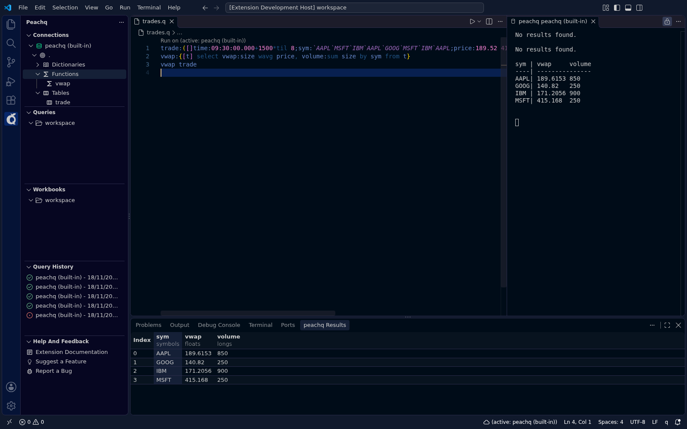
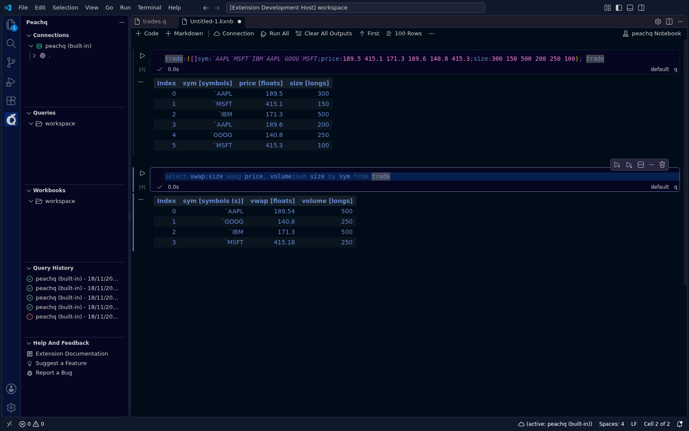

# peachq for Visual Studio Code

q language support for VS Code: run, chart and lint q against any kdb+ process,
or with built-in peachq — no licence, no server.

## Features

- **Console and grid together.** A run's text always goes to the console, and
  tables, dictionaries and keyed tables also land in the results grid, with
  typed columns, without taking focus.
- **Built-in peachq.** The Linux (x64, arm64), macOS (Apple silicon) and Windows
  (x64) packages carry [peachq](https://peachq.org), an open-source (MIT) q.
  Connect to **peachq (built-in)** and q runs on your machine with nothing else
  installed.
- **Connections and variable browser.** Connect to any number of q processes
  over kdb+ IPC, with authentication and TLS. The Connections view lists each
  process's namespaces, tables, functions, variables, views and dictionaries.
- **Notebooks.** `.kxnb` notebooks mix q, Python and SQL cells and show tables
  inline.
- **REPL.** **peachq: Start REPL** runs q in a terminal, using your own q first
  and the bundled peachq only when it finds none.
- **Whole file "as if `\l`".** **Execute Whole File as if loaded with \l**
  (`ctrl`+`shift`+`d`) runs a script statement by statement in its namespace;
  the differences from a real `\l` are listed in the reference card.
- **Per-server query modes.** Each connection chooses what a run sends: the
  `.vscode` API, a qStudio-style wrapper, upstream's lambda, or your text as it
  is.
- **Language features.** Syntax highlighting, completion, go to definition,
  rename and optional linting for q.
- **Coexists with the KX extension.** Install both: in a window where the KX
  extension is enabled, peachq pauses its q features, and it can import the KX
  extension's connections and settings.

## Getting started

1. Install **peachq** from the Extensions view.
2. Open the peachq view in the activity bar. Under **Connections**, right-click
   **peachq (built-in)** and choose **Connect server**. The extension starts
   peachq on `127.0.0.1` with a one-off password and stops it when you
   disconnect or close the window. It is never written to your settings.
3. Open or create a `.q` file, put the cursor on a line and press `ctrl`+`d`
   (`⌘`+`d` on macOS) to run it, or select several lines first.

To use your own kdb+ or q process, click **+** in the Connections view, give the
host and port (and a username and password if the process uses `-u` or `-U`),
and connect. Your own q always comes first: the REPL uses the bundled peachq
only when no q is found through `peachq.qHomeDirectoryWorkspace`, `QHOME`,
`peachq.qHomeDirectory`, `~/.kx/bin/q` or `PATH`.

## Migrating from the KX extension

peachq installs beside the KX extension. While the KX extension is enabled in a
window, peachq pauses its language server and keybindings there, and asks once
whether to keep KX or use peachq in that workspace.

To move over, run **peachq: Import Connections and Settings from the KX
Extension**. It copies your user-level connections and `kdb.*` settings to the
`peachq.*` ones you have not set. Passwords stay in the KX extension's secret
storage, so peachq asks for each one on first connect.

## Settings highlights

| Setting                                                   | What it does                                                                                   |
| :-------------------------------------------------------- | :--------------------------------------------------------------------------------------------- |
| `peachq.results.grid`                                     | `always` (default) also puts tables in the results grid; `never` keeps results in the console. |
| `peachq.peachqArgs`                                       | Arguments for every peachq the extension starts; default `["-classic"]`.                       |
| `peachq.deferToKx`                                        | `auto` (default) pauses peachq's q features beside the KX extension; `never` keeps them on.    |
| `peachq.qHomeDirectory`, `peachq.qHomeDirectoryWorkspace` | Where the REPL looks for your q.                                                               |
| `peachq.linting`                                          | Lint q files as you edit.                                                                      |
| `peachq.connectionMap`, `peachq.targetMap`                | The connection and target each workspace file runs on.                                         |

A connection's **Query mode** (`auto`, `naked`, `qstudio-wrap`, `vscode-wrap`)
is set in the connection form, under Advanced.

## Reference

- [Reference card](https://github.com/ryanhamilton/kx-vscode/blob/dev/docs/user/reference-card.md):
  every command, keybinding and setting
- [User notes](https://github.com/ryanhamilton/kx-vscode/blob/dev/docs/user/index.md)
  and
  [developer notes](https://github.com/ryanhamilton/kx-vscode/blob/dev/docs/developer/index.md)

## Data and telemetry

This extension collects no usage data and sends no telemetry.

## Licence

Apache License 2.0. peachq for VS Code is a modified version of the kdb VS Code
extension by KX Systems, Inc.; see
[NOTICE](https://github.com/ryanhamilton/kx-vscode/blob/dev/NOTICE) and the
[CHANGELOG](https://github.com/ryanhamilton/kx-vscode/blob/dev/CHANGELOG.md).

kdb+, KDB-X, kdb Insights and KX are trademarks of KX Systems, Inc. peachq is
not affiliated with or endorsed by KX.

## Links

- [Issues](https://github.com/ryanhamilton/kx-vscode/issues)
- [peachq.org](https://peachq.org)
